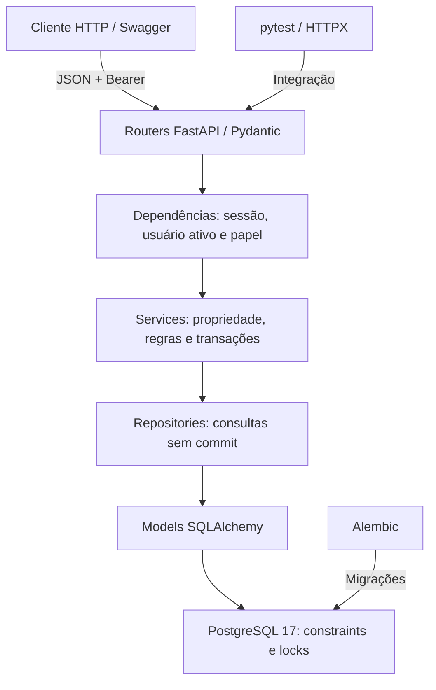
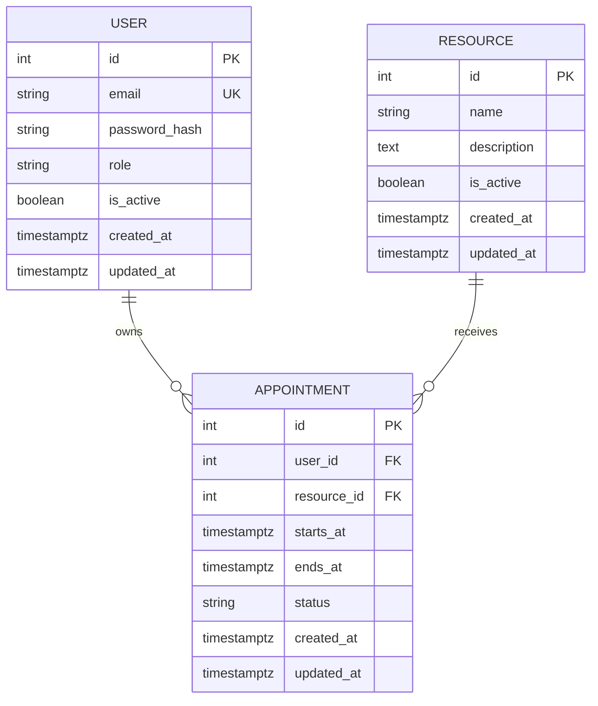

# Arquitetura e modelo

Cada requisição abre sua AsyncSession. A camada service controla commit/rollback
para mudanças; repositories apenas consultam. No encerramento, a dependência
faz rollback de transações ainda abertas, incluindo leituras e regras recusadas.
Toda tarefa concorrente usa sua própria sessão e conexão.

Não existe exclusão de salas pelo HTTP. Desativação preserva histórico e FKs RESTRICT
impedem remoção de referências. O modelo não armazena empresa/tenant: há uma organização.

| Ação | Público | Client | Admin |
|---|---|---|---|
| Cadastrar client, login, saúde | Sim | Sim | Sim |
| Consultar perfil | Não | Próprio | Próprio |
| Consultar salas e disponibilidade | Não | Sim | Sim |
| Criar/editar/desativar sala | Não | Não | Sim |
| Criar reserva | Não | Para si | Para si |
| Consultar/alterar/cancelar reserva | Não | Própria | Qualquer |
| Filtrar listagem por usuário | Não | Não | Sim |
| Promover papéis via API | Não | Não | Não |

O comando administrativo cria um admin; não há endpoint público de alteração de papel.
Admin respeita as mesmas regras temporais dos clientes. Não há criação de reserva em
nome de terceiros no núcleo. O endpoint adicional GET /resources/{id} resolve o
Location retornado na criação.
